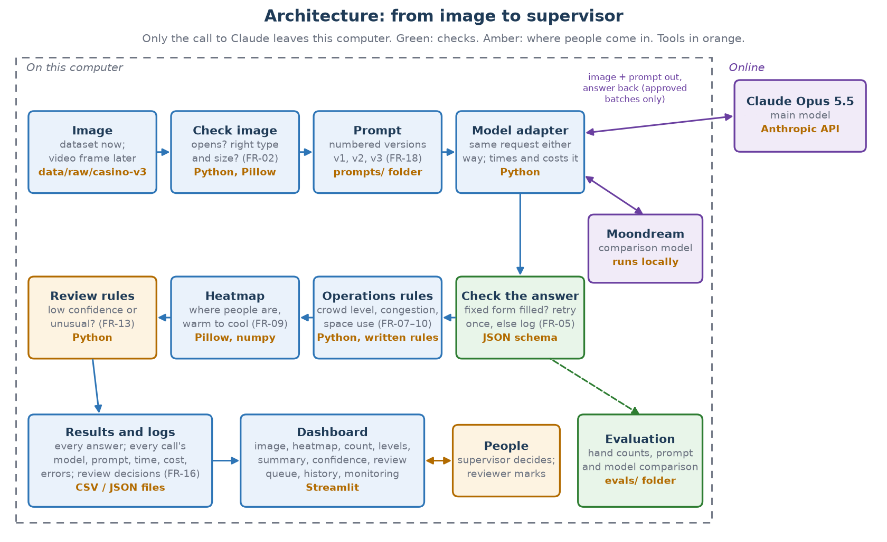

# AI Architecture & Decision Log: Casino Floor Operations Intelligence System

> **Status:** v1.0, approved 13 Nov 2026 (D9). Section 1–2 describe the design before it's built; they're updated as each part is built and tested.
> **Updated at close, 23 Nov 2026:** statuses and figures brought up to date with the final results, after mentor feedback on Week 4 asked for every document to give the same final position (D27).
> Requirements referred to (FR-…) are in the BRD (02). This document is the **single decision log** for Week 5 (D7).

---

## 1. System architecture

**In one paragraph:** each image is checked, then sent with a numbered prompt to a multimodal model through one **model adapter**, which works the same way for Claude (online) and Moondream (on this Mac). The answer must fill a **fixed form**. If it doesn't, it's retried once, then logged as failed. Written **operations rules** turn the answer into a crowd level, a congestion status and space use. The **heatmap** shows where people are, and **review rules** decide whether a person should check the result. Everything is saved, with the model, prompt, time and cost of every call. The **dashboard** shows it to the supervisor, and holds the review queue. The **evaluation** scripts compare answers with our hand counts.

**Only the call to Claude leaves this computer,** and only for batches the Product Owner has approved.

---

## 2. Components

| Component | What it does | Tool | Requirements |
|---|---|---|---|
| Image source | The dataset images now. Later, video frames with a time and camera name | Files in `data/raw/casino-v3` | FR-01, FR-22 |
| Image check | Confirms the file opens and is a supported type and size, before anything is sent | Python, Pillow | FR-02 |
| Prompt library | The instructions given to the model, as numbered versions (v1 simple, v2 strict format, v3 strict format plus operational rules, **v3.1 adds the 3×3 grid: the product prompt**, D17) | Text files in `prompts/` | FR-18 |
| Model adapter | Sends the image and prompt to the chosen model, and records time, tokens and cost. The same interface for both models, so either can be swapped in | Python; Anthropic SDK for Claude; Ollama for Moondream (D19) | FR-03, FR-16 |
| Claude Opus 5.5 | The main model, online. Answers using **structured output**: the API forces the answer into our fixed form | Anthropic API (D5, D6) | FR-03, FR-04 |
| Moondream | The comparison model, on this Mac, free per image. It has no forced form, so its answers rely more on the format check | Small open vision model (D5) | FR-20 |
| Answer check | Checks every field is present and valid. Retries once, then records a failure. Never guesses | JSON schema check | FR-04, FR-05 |
| Operations rules | Crowd level (Normal / Busy / Highly occupied), congestion (three statuses), space use (people per part of the image). All written rules, labelled prototype | Python | FR-07, FR-08, FR-10 |
| Heatmap | Turns where people are into a warm-to-cool overlay on the image. Positions come from Claude's count for each square of a 3×3 grid (D15) | Pillow, numpy | FR-09 |
| Review rules | Flags results for a person: low confidence, high concentration, not a casino floor, a failed or rejected answer, or a random 1-in-10 spot-check (D21) | Python | FR-13 |
| Results and logs | Every answer, every call (model, prompt version, time, cost, errors) and every review decision | CSV / JSON files in `data/results/` | FR-16 |
| Dashboard | What the supervisor and reviewer use: image, heatmap, count, levels, summary, confidence, review flag, history, monitoring | Streamlit (installed in Phase 6, with approval) | FR-14, FR-15, FR-17 |
| Evaluation | Hand counts, the counting table, prompt and model comparisons, error analysis | `evals/` folder, Python | FR-19, FR-20 |

### 2.1 What a structured answer looks like (draft, finalised in Phase 2)

| Field | Type | Tag (FR-21) |
|---|---|---|
| people_count | whole number | estimated |
| crowd_level | Normal / Busy / Highly occupied | estimated, prototype |
| main_occupied_area | part of the image, e.g. "centre-left" | estimated |
| low_activity_area | part of the image | estimated |
| congestion | No visible congestion / Moderate congestion / High concentration requiring review | estimated, prototype |
| visible_floor_objects | list | estimated |
| confidence | low / medium / high | estimated (the model's own claim) |
| operational_summary | 2–4 sentences | estimated |
| model, prompt_version, seconds, tokens, cost | recorded with every answer | measured |

### 2.2 How the AI quality requirements are met

| AI quality requirement (02, section 6) | How |
|---|---|
| Counting accuracy | Evaluation against hand counts (D3), reported by group: empty, quiet, busy, dark |
| Format reliability | Structured output on Claude; a schema check and one retry for both models; failures logged |
| No unsupported statements | Prompts v3 and v3.1 forbid them. The summary is written from the fields only. Checked by hand on the evaluation set |
| Consistency | Each evaluation image run three times; the spread is reported |
| Crowd-level agreement | The same written rule applied to the model's count and to the hand count |
| Honest confidence | Accuracy compared across the low, medium and high confidence groups |
| Privacy in outputs | Prompts forbid describing individuals; outputs hold counts and areas only; checked by hand |
| Declines handled | A decline is recorded as such. Claude calls use the API's automatic fallback, which is also logged |

---

## 3. Decision log

Every decision: what, why, and who decided. The experiments behind them, run by run, are in `evals/experiment-log.md`. Letters (A, B …) refer to the decisions listed in the brief tracker (`docs/week5-plan.md`).

| # | Date | Decision | Why | Who |
|---|---|---|---|---|
| D1 | 13 Nov 2026 | Week 5 is built as planned in `docs/week5-plan.md`: seven phases, one at a time, with a sign-off at the end of each. It lives in its own folder, `Week 5 Project` | Same way of working as Week 4: every brief bullet is tracked, and you decide before anything leaves your computer | Tez, 13 Nov 2026 ("Yes, start Phase 1") |
| D2 | 13 Nov 2026 | **Decision A:** the dataset (Roboflow "Casino" version 3, COCO JSON format) was downloaded by you through the browser, with a free Roboflow account. It's kept unchanged, and its size and fingerprint are recorded (`data/raw/MANIFEST.md`) | The dataset is fixed, so a download script would add little. Downloading from Terminal is blocked by Roboflow's bot check | Tez, 13 Nov 2026 |
| D3 | 13 Nov 2026 | **Decision C:** the dataset's person labels are **not** used as the true count. The evaluation images are counted by hand, and the labels are only a cross-check | Inspection found crowded scenes under-labelled (17 labelled where more than 50 are visible), people in shadow without boxes, "0 people" images that contain people, and people labelled as chairs (`docs/week5-dataset.md`) | Tez, 13 Nov 2026 |
| D4 | 13 Nov 2026 | Use case approved as drafted (`docs/week5-use-case.md`). The main user is the floor operations supervisor. Six product rules: it supports decisions and never makes them; occupancy only, with no identifying anyone; prototype levels are labelled as such; no safety claims; nothing beyond the image; when unsure, a person reviews. Success targets are set after the first results. **Phase 1 closed** | Defines what the system is for before any model work, so every later step can be judged against it | Tez, 13 Nov 2026 |
| D5 | 13 Nov 2026 | **Decision B:** two multimodal models. **Claude** (Anthropic, online), the main model; and **Moondream** (small open model, run locally on this Mac), for comparison (Step 11) | A strong online model against a free, private local one is the most useful contrast, and it matches the privacy question a real casino would ask (Step 20). One API key you already have, no new account. The Mac (M1, 8 GB memory, 7.9 GB free disk) can run Moondream, but not larger local models. OpenAI vision wasn't chosen: similar to Claude, and it needs a new account and billing | Tez, 13 Nov 2026 |
| D6 | 13 Nov 2026 | The Claude model is **Claude Opus 5.5** (`claude-opus-5-5`), priced at $4 per million tokens in and $20 per million out. Every call records its tokens, time and cost from the first run (Steps 11, 17). Answers use structured output (a fixed form the model must fill). If Claude declines an image, the API retries it on a fallback model automatically | Connection test on one image: 4 people counted (correct), 3.6 seconds, 941 tokens in and 121 out, **$0.0062 per image**. Estimated for the whole project, about 300–400 calls: **roughly $2–4**. Moondream costs nothing per image (it runs on this Mac), but is slower | Tez, 13 Nov 2026 (asked for cost from the start) |
| D7 | 13 Nov 2026 | The standard project documents are created as in Week 1, numbered 01–10: brief, requirements, architecture and decision log, project plan, Gantt chart, risk register, evaluation plan (plus an `evals/` folder), UAT workbook, case study, change control log. Also README, CHANGELOG and HANDOVER. 01–05, 07 and 10 come before the pipeline is built. The use case folds into 01 and 02, and this decision log moves into 03 | Requirements should drive the build, not follow it, and the set matches the course's standard from Week 1 | Tez, 13 Nov 2026 |
| D8 | 13 Nov 2026 | Product brief (01) and business requirements (02) approved as v1.0. The requirements are the baseline: FR-01 to FR-22, the AI quality and non-functional requirements, and a proposed API budget under $10. Later changes go through the change control log (10) | Requirements drive the build and the UAT tests (08) | Tez, 13 Nov 2026 |
| D9 | 13 Nov 2026 | Architecture (03), project plan (04) and Gantt chart and schedule (05) approved as v1.0. The proposed dates run to 22 Nov 2026 | The design and the plan are agreed before the build. Dates can move through the change log if the course deadline differs | Tez, 13 Nov 2026 |
| D10 | 13 Nov 2026 | Evaluation plan (07), labelling guide and change control log (10) approved. True counts are made by Tez, not an AI. The evaluation set is about 30 images, chosen before any model results, and kept as a CSV file. The fixed pass marks come from 02; the counting marks are set after the first results | The judge must be independent of the model being judged, and the set must be fixed before results are seen | Tez, 13 Nov 2026 |
| D11 | 13 Nov 2026 | **Both Claude Opus 5.5 and Claude Sonnet 5.5 go into the counting evaluation** (Phase 3); the model is chosen on the results. Until then Opus 5.5 stays the chosen model (D6). Pipeline v1 works, so **Phase 2 is closed** | Trial on 5 images (CR-05, CR-06): Sonnet is half the cost ($0.0082 against $0.0170 per image, inside the $0.01 limit) but counts lower on hard images. Which is right needs the hand counts. Both in the evaluation cost about $2.30 | Tez, 13 Nov 2026 |
| D12 | 14 Nov 2026 | **The product uses Claude Opus 5.5 with prompt v3** (the answer form plus operational rules), at medium effort. The cost limit rises from $0.01 to **$0.025 per image** (CR-10). Sonnet 5.5 is not adopted; Sonnet-first escalation is noted for a real floor | Phase 3 evaluation on 30 hand-counted images (`evals/results/20261113_phase3_summary.md`): Opus + v3 was within ±1 or 20% on 88% of 90 answers, average miss 2.6 people, and kept 75–80% within on crowds of 16+. Sonnet failed crowds (0% within over 50 people). Prompt v1 (free text) gave a count on only 6 of 30. Crowds are what operations most needs, so accuracy outweighs the cost difference ($0.020 against $0.008) | Tez, 14 Nov 2026 |
| D13 | 14 Nov 2026 | **Counting pass marks set** (07, section 6): at least 85% of counts within ±1 or 20%; average miss 3 people or fewer; 100% within on scenes of 0–5 people; at least 75% within on crowds of 16+; at least 85% of images consistent across 3 runs. They become the baseline for monitoring alerts (Step 17). **Phase 3 closed** | Set from what Opus + v3 achieved in Phase 3 and what a supervisor could live with. They describe what the prototype can do; they are not proof on new data | Tez, 14 Nov 2026 |
| D14 | 14 Nov 2026 | **Decision D, crowd levels (prototype):** worked out from the people count by a written rule: **Normal 0–10, Busy 11–30, Highly occupied 31 or more.** The model's own crowd label is kept for the record but not shown as the result | The model's own label changed between runs on about 1 image in 6 (Phase 3). A count-based rule is consistent and checkable. On the 30 evaluation images it gives 18 Normal, 5 Busy, 7 Highly occupied (`docs/diagrams/4_crowd_levels.png`). Real thresholds would be set per area with operations | Tez, 14 Nov 2026 |
| D15 | 14 Nov 2026 | **Decision E, heatmap positions:** Claude gives the people count for each square of a **3×3 grid** (top, middle, bottom × left, centre, right). The heatmap is drawn from these 9 numbers; the thirds are the column totals. Needs answer form v2 and prompt v3.1, then a re-run of the 30 evaluation images (about $0.60) to check counting doesn't get worse | Matches the hand-counting sheets, so it can be checked against Tez's thirds; 9 numbers are cheap. A dot per person is costly in crowds and hard to check; a separate detector is a large install; the dataset's boxes miss most people | Tez, 14 Nov 2026 |
| D16 | 14 Nov 2026 | **Decision F, congestion (prototype):** from the 3×3 grid, by a written rule: **No visible congestion** when every square has fewer than 6 people; **Moderate congestion** when any square has 6–14; **High concentration requiring review** when any square has 15 or more. Never "unsafe" | The model's own congestion label changed between runs on about 1 image in 4 (Phase 3). A square is one ninth of the picture, so the rule points at a place. Checked by eye, since hand counts are by thirds, not squares. Real limits would be set per camera and area | Tez, 14 Nov 2026 |
| D17 | 14 Nov 2026 | **Prompt v3.1 (with the 3×3 grid) adopted for the product**, replacing v3 | Re-run on the 30 evaluation images ($0.70): 30 of 30 in the form; 93% of counts within ±1 or 20% (v3: 88%); 89% within on crowds of 16+ (v3: 78%); crowd level from our rule matches the hand count's level on 93% of images; busiest third matches on 80%; $0.023 per image. It **misses one pass mark**: average miss 3.8 people against the limit of 3, almost all from E01 (160 counted against 200, still within 20%). Accepted knowingly, because the heatmap (Step 7) needs the grid. Watch this in monitoring | Tez, 14 Nov 2026 |
| D18 | 14 Nov 2026 | **Crowd-level pass mark: at least 85%** of images get the same crowd level as the hand count. Heatmaps checked by Tez against all 30 photos: all match. **Phase 4 closed** | Opus + v3.1 reached 93%; the 2 misses (E24, E25: 27 against 32) sit next to the 30-person line (`evals/results/20261114_phase4_summary.md`) | Tez, 14 Nov 2026 |
| D19 | 14 Nov 2026 | **Model comparison (Step 11) concluded: Claude Opus 5.5 is the model for the product.** Moondream is not suitable today. Ollama and Moondream stay installed until the end of the project, then can be removed | Same 30 images: Claude 93% within, 30 of 30 full answers, $0.023 and 9 s per image. Moondream 47% within, usable counts on 22 of 30 (8 impossible numbers), 0% on crowds, full form 0 of 5, free, 7.5 s to over 2 minutes (`evals/results/20261114_model_comparison.md`). A private on-premises option would need a larger local model and stronger hardware | Tez, 14 Nov 2026 |
| D20 | 14 Nov 2026 | Summary check accepted: of Claude's 30 own summaries, **no** descriptions of individuals, **no** safety or staffing claims, **no** clearly unsupported statements; 2 borderline statements (E29 "holding a dealer stick", E30 "event-style … not a standard casino floor") accepted as reasonable. Error analysis written (Step 13). **Phase 5 closed** | `evals/results/20261114_error_analysis.md`: the big misses are crowds of 32+ in elevated views; 5 of 6 were marked low confidence, which supports using confidence as a review trigger | Tez, 14 Nov 2026 |
| D21 | 14 Nov 2026 | **Decision G, review triggers:** a result goes to human review if (1) Claude's confidence is low, (2) congestion is High concentration requiring review, (3) Claude says the image isn't a casino floor, (4) the answer failed or was rejected, or (5) it's picked in a random 1-in-10 spot-check | On the 30 evaluation images, triggers 1–4 send 9 (30%); low confidence alone caught 5 of the 6 biggest misses (Step 13). The spot-check catches quiet errors such as E17 (off by 3 at medium confidence) | Tez, 14 Nov 2026 |
| D22 | 14 Nov 2026 | **Monitoring alert limits (Step 17)**, over the last 50 calls of the product setting: failed requests over 5%; rejected answers over 5%; low-confidence answers over 30%; average response over 15 s; average cost over $0.025 per image; reviews marked incorrect over 20% (once 10+ reviewed); or the latest evaluation failing any pass mark (`scripts/monitoring.py`) | Each limit sits above normal behaviour (low confidence 20%, 9 s, $0.023) so it fires only on a real change. On today's data it fires twice, correctly: the out-of-credit failures (40%) and the average-miss pass mark (3.8) | Tez, 14 Nov 2026 |
| D23 | 15 Nov 2026 | **UAT accepted; Phase 6 closed.** Business UAT 12 of 12 passed (Tez); system and AI tests 28 pass, 4 partly, 1 fail (average miss, accepted in D17), 1 not run (video-ready input, Phase 7). 10 defects: 5 fixed, 1 accepted, 4 open (`docs/casino-floor-intelligence-08-user-acceptance-testing.xlsx`) | UAT found 2 real bugs with uploaded images (DF-09, DF-10), both fixed and re-checked, and real evidence of review rubber-stamping (DF-08) for the risk register | Tez, 15 Nov 2026 |
| D24 | 15 Nov 2026 | Video design (Step 16), product decisions (Step 18) and risk register (06, Step 19) approved. Three risks stay High after protections: R-07 (a real casino differs), R-10 (trusting without checking, seen in UAT), R-09 (privacy of footage) | Each risk carries evidence from the evaluation and UAT; real deployment conditions are in the product decisions, section 7 | Tez, 15 Nov 2026 |
| D25 | 15 Nov 2026 | Privacy and responsible use (Step 20) and limitations (Step 21) approved. The proposed real-use retention (frames deleted after analysis; flagged images up to 7 days; counts 90 days; logs 1 year; no faces stored) is for the casino to confirm | The prototype runs on public photos; a real deployment needs privacy, legal, security, operations and surveillance approval first | Tez, 15 Nov 2026 |

| D26 | 23 Nov 2026 | **Fresh test on 20 unseen images** (F01–F20): never sent to any model, hand-counted by Tez first, then run once on the product setting. Same mix of groups as the evaluation set (`scripts/make_fresh_set.py`, seed 26). Results reported whatever they show | Mentor feedback on Week 4 asked for real validation on new data. The 30 evaluation images also chose the prompt (v3 → v3.1), so they're no longer a fully fair test. Still web photos, not CCTV. **Changed the same day:** Tez chose an automatic test instead of hand counts, so accuracy isn't scored. **Result:** 60 of 60 in the form; consistency 95% within the margin (pass); crowd level the same in all 20; 8.9 s and $0.0241 on average; low confidence 32%, over the 30% alert. Found and fixed bug DF-11 (monitoring ignored new calls). Write-up: `evals/results/20261123_fresh_test.md` | Product Owner (Tez), 23 Nov 2026 |
| D27 | 23 Nov 2026 | **Documents brought into line at close:** every document gives the same final figures and statuses (01 assumptions, 02 targets, 03 components, 04 phases, 05 schedule, 07 pass marks, 10 current versions). Consistency is reported as two named measures: within the margin across 3 runs (87%) and exactly the same count (63%). The case study gains the decision the product supports and its value in money | Mentor feedback on Week 4: documents inconsistent, business value missing | Product Owner (Tez), 23 Nov 2026 |
| D28 | 25 Nov 2026 | **View-only mode for demos:** started with `VIEW_ONLY=1`, the dashboard hides "Analyse a new image" (the only call to Claude) and doesn't save review decisions. Every page still shows the saved results | The mentor sees the dashboard on a screen-share without spending API credit or changing the results; switched off by starting the dashboard normally | Product Owner (Tez), 25 Nov 2026 |

**Open decisions:** none. Decisions D to H were all made (D14, D15, D16, D21; dashboard D21–D23; GitHub public, 15 Nov).

---

## 4. Where humans stay in the loop

| Point | Who | What they do |
|---|---|---|
| Before any batch goes online | Product Owner | Approves which images are sent, and the cost |
| Every flagged result | Reviewer | Marks it correct or incorrect, with a note (FR-14) |
| Every decision on the floor | Supervisor | Decides. The system only points (D4) |
| Thresholds and prompt changes | Product Owner | Approves them through the change control log (10) |
| Evaluation | Delivery Lead | Counts people by hand; inspects failures (Steps 5, 13) |

---

## 5. Risks the architecture introduces

| Risk | Where | Mitigation |
|---|---|---|
| Images leave the computer | Claude calls | Public dataset only; approval per batch; real footage needs privacy approval (A6) |
| Moondream answers don't fit the form | No forced structured output | Schema check, one retry, failures logged and counted in the comparison |
| A wrong count spreads | Crowd level, congestion and heatmap all depend on the count or positions | Counting is evaluated first; review triggers on unusual counts |
| The model changes behind the same name | Online model | Model name and version recorded on every call; monitoring alerts (FR-17) |
| Cost creeps up | Repeated runs | Cost logged per call; the project budget is under $10 (02) |
| Thresholds look official | Crowd and congestion levels | Labelled prototype everywhere; real values agreed with operations |
