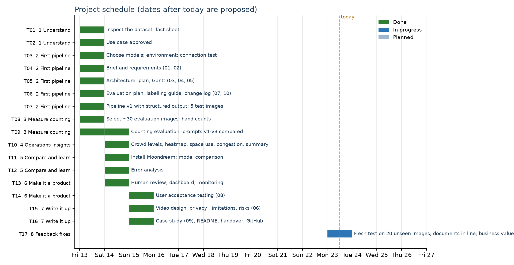

# Project Plan: Casino Floor Operations Intelligence System

> **Status:** v1.0, approved 13 Nov 2026 (D9). Dates after today are a **proposal**, to fit the deadline.
> **Updated at close, 23 Nov 2026:** statuses and figures brought up to date with the final results, after reviewer feedback on the revenue forecasting project asked for every document to give the same final position (D27). All seven phases finished on 15 Nov 2026, ahead of the proposed dates.
> The bullet-by-bullet tracker of the brief is `docs/plan.md`. The task list is `docs/casino-floor-intelligence-05-project-schedule.csv`, drawn by `scripts/project_schedule.py`.

---

## 1. Summary

A prototype that turns casino floor images into operations information, built and tested in **seven phases**, one at a time. Each phase ends with a short recap and the Product Owner's sign-off (D1).

| | |
|---|---|
| Start | 13 Nov 2026 |
| Proposed finish | 22 Nov 2026 |
| Done so far | Phase 1 (understand the dataset and use case); Phase 2 groundwork (models chosen, environment, connection test, brief and requirements approved) |
| Budget | API spend under $10 (02). Spent: $6.64, including the fresh test (D26, $1.45) |
| Team | Tez (Product Owner and Delivery Lead) with Claude (build and documents) |

---

## 2. Phases

| Phase | Brief steps | Deliverables | Sign-off |
|---|---|---|---|
| **1. Understand** | 1–2 | Dataset fact sheet; use case (now in 01 and 02) | **Done** (D3, D4) |
| **2. First pipeline** | 3–4 | Models chosen (D5, D6); environment; documents 01–05, 07 and 10; pipeline v1 with structured output, tried on 5 images | **Done** (D8, D9, D11) |
| **3. Measure counting** | 5, 12 | About 30 hand-counted evaluation images; counting table and error; prompts v1–v3 compared; counting target set (Q1) | **Done** (D12, D13) |
| **4. Operations insights** | 6–10 | Crowd-level rule and thresholds; heatmap; space use; congestion rule; management summary | **Done** (D14 to D18) |
| **5. Compare and learn** | 11, 13 | Moondream installed; model comparison table; error analysis | **Done** (D19, D20) |
| **6. Make it a product** | 14, 15, 17 | Human review; dashboard; monitoring and alerts; UAT run (08) | **Done** (D21 to D23) |
| **7. Write it up** | 16, 18–22 | Video design; product decisions; risk register (06); privacy note; limitations; case study (09); README, CHANGELOG, HANDOVER; GitHub; annotated brief | **Done** (D24, D25). Feedback fixes: D26, D27 |

---

## 3. Gantt chart

---

## 4. Task schedule

The full list, with dependencies, is in `casino-floor-intelligence-05-project-schedule.csv`: 16 tasks (T01–T16), each linked to its brief steps or documents. 5 are done, 1 is in progress and 10 are planned (13 Nov).

---

## 5. Milestones

| # | Milestone | Proposed date | Status |
|---|---|---|---|
| M1 | Requirements approved (01, 02) | 13 Nov | **Done** (D8) |
| M2 | Pipeline v1 working on 5 images, with structured output | 14 Nov | |
| M3 | Counting measured; best prompt chosen; counting target set | 16 Nov | |
| M4 | Operations insights working (levels, heatmap, congestion, summary) | 17 Nov | |
| M5 | Model comparison and error analysis complete | 18 Nov | |
| M6 | Dashboard, review and monitoring working; UAT passed | 20 Nov | |
| M7 | All deliverables complete and on GitHub | 22 Nov | |

---

## 6. Critical path and dependencies

**Critical path:** pipeline v1 (T07) → hand counts (T08) → counting evaluation (T09) → operations insights (T10) → dashboard (T13) → UAT (T14) → write-up (T16).

- **Hand counts gate everything after Phase 3.** Thresholds, the model comparison and the error analysis all need them (D3).
- **Moondream (T11) can slip without delaying the dashboard,** but Step 11 needs it before the write-up.
- **Every online batch needs your approval** before it runs (02, section 8). A quick yes keeps the path moving.

---

## 7. Assumptions and constraints

| Type | Detail |
|---|---|
| Constraint | This Mac: M1, 8 GB memory, about 7 GB free disk. Moondream fits; larger local models don't |
| Constraint | API budget under $10 *(proposed in 02)* |
| Constraint | The dataset is fixed (version 3) and is web photos, not CCTV |
| Assumption | About 30 hand-counted images are enough to measure counting. Revisited after the first results |
| Assumption | The dates fit the timetable. **To confirm** |
| Assumption | Streamlit and Moondream installs are approved when their phases arrive |
