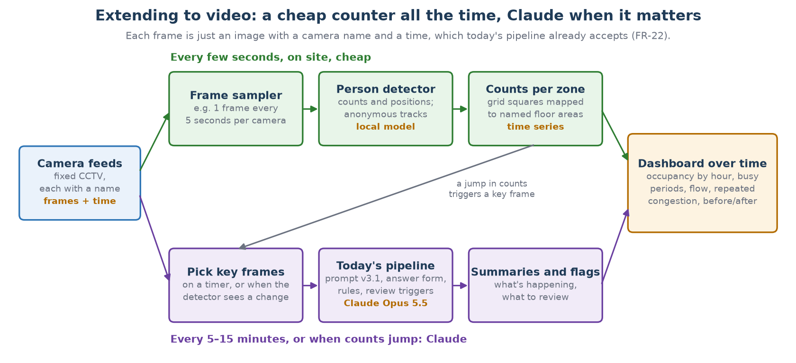

# Preparing for video (Step 16)

**Status:** design note, 15 Nov 2026. Video is designed for, not built (the brief: "you do not need to implement all of this now"). One small part is built now: every analysis accepts a **camera name and a time** (FR-22, defect DF-07 closed).

---

## 1. Why video matters

A single image shows **one moment**. It can't show movement, flow, or whether an area stays busy. Video, analysed frame by frame, would let the product answer the questions the brief lists: movement direction, traffic flow, occupancy over time, repeated congestion, busy periods, movement between areas, average occupancy by time period, and changes before and after an operational decision.

---

## 2. What today's design already gives video

| Already built | Why it matters for video |
|---|---|
| **A frame is just an image + camera name + time.** Every result stores both (FR-22) | Results line up into a time series per camera, with no redesign |
| The **3×3 grid** of counts per image | Each square can be mapped to a named floor area per camera (e.g. "top-left = poker room entrance") |
| **Written rules** for crowd level and congestion | Can be applied to every frame, and over time ("congested in 3 of the last 4 checks") |
| **Review triggers and monitoring** | Work the same on frames; monitoring watches cost and speed as volume grows |
| **History page** | Becomes a timeline when results carry a time |

---

## 3. The proposed design

**A cheap counter runs all the time; Claude runs when it matters.**

1. **Every few seconds, on site:** a frame sampler takes one frame every few seconds per camera. A small **local person detector** counts people and their positions, and keeps **anonymous tracks** (a number for each moving person, never an identity). Counts are stored per floor area as a time series.
2. **Every 5–15 minutes, or when counts jump:** a key frame goes through **today's pipeline** (Claude Opus 5.5, prompt v3.1, the answer form, rules and review triggers) for the summary, observations and flags.
3. **The dashboard** shows occupancy over time, busy periods, flow and repeated congestion, and marks operational decisions so before and after can be compared.

**Why not send every frame to Claude?** Cost. At $0.023 per image:

| Frames sent to Claude | Per camera per day | 50 cameras per day |
|---|---|---|
| 1 a minute | $33 | $1,656 |
| 1 every 5 minutes | $6.60 | $331 |
| 1 every 15 minutes | $2.20 | $110 |

A local detector costs nothing per frame, so it does the continuous counting, and Claude is kept for understanding and summaries.

---

## 4. How each future capability would work

| Capability (brief) | How | Needs |
|---|---|---|
| Movement direction | Anonymous tracks from the detector, frame to frame | Detector with tracking |
| Traffic flow | Count tracks crossing a line drawn on each camera's view | Lines set up per camera |
| Occupancy changes over time | The count time series per floor area | Times on frames (built) |
| Repeated congestion | The congestion rule over time, e.g. high in 3 of the last 4 checks | Rule over a time window |
| Busy periods | Average occupancy by hour and day | Weeks of data |
| Movement between areas | Tracks passing from one camera's area to the next | Camera layout map; **no re-identification of people** |
| Average occupancy by time period | Averages of the time series | Times on frames (built) |
| Before and after operational decisions | Mark the decision on the timeline ("opened table 5 at 21:00") and compare the windows either side | Decision log in the dashboard |

---

## 5. What a real deployment would add

- **Fixed cameras with named zones**, and each zone's **capacity**, so "busy" can become a real utilisation figure. Today's photos have neither (fact sheet).
- **Thresholds per zone**, agreed with operations (today's are prototype values).
- **A new evaluation on real CCTV frames:** the web photos tested here don't match fixed, high CCTV angles (limitations, Step 21).
- **Privacy approval** for continuous footage and tracking: short retention, anonymous tracks only, no faces stored (privacy note, Step 20).
- **Cost and speed monitoring at scale:** the alert limits (D22) already cover cost and response time.
