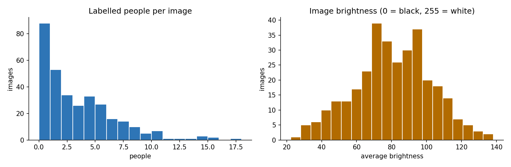

# Week 5 dataset fact sheet (Step 1)

**What this is:** the dataset exactly as it is, checked before building anything. It records what the dataset gives us directly, what it doesn't have, and what we'll have to calculate or estimate ourselves, as the brief asks.

**Evidence:** `scripts/inspect_dataset.py` → `data/inspection/` (per-image table, summary, charts, sample sheets with the labels drawn on).

---

## 1. Source

| | |
|---|---|
| Dataset | "Casino", by Roboflow user *sva*, on Roboflow Universe |
| Version | 3, made 23 May 2024 (fixed: it won't change) |
| Link | https://universe.roboflow.com/sva-q5vsp/casino-vavjk/dataset/3 |
| Format | COCO JSON (explained in section 2) |
| Downloaded | 13 November 2026, through the browser with a free Roboflow account (D2) |
| File | `data/raw/Casino.v3i.coco.zip`, 21.9 MB. Fingerprint in `data/raw/MANIFEST.md` |
| Licence | CC BY 4.0: free to use, crediting the author |
| Where the photos come from | Every original file name starts with `sun_`. That points to the public **SUN** scene-photo collection: photos taken from the web, not casino CCTV |

---

## 2. How it's organised

```
casino-v3/
  train/   240 images + _annotations.coco.json
  valid/    25 images + _annotations.coco.json
  test/     57 images + _annotations.coco.json
```

- **Each label file (COCO JSON)** has three lists:
  - **images:** each file's name and size;
  - **categories:** the four kinds of thing labelled;
  - **annotations:** one entry per labelled thing, giving the image it's in, its category and a **box**. A box is the top-left corner plus the width and height, in pixels.
- **The three splits** (train, valid, test) were made for training detection models. We aren't training a model, so we treat all 322 images as one pool. We do note which split each image came from.
- **Every image is 640 × 640 pixels.** Roboflow **stretched** them to this size from their original shapes, so many look slightly squashed or widened.

---

## 3. What's labelled

| Label | Boxes | Images with at least one | Typical box size (% of image) | Boxes cut off by the image edge |
|---|---|---|---|---|
| person | 980 | 234 | 4.1% | 20% |
| slots (slot machine) | 785 | 185 | 2.5% | 17% |
| chair | 679 | 170 | 2.3% | 23% |
| table | 276 | 141 | 5.1% | 38% |

- There is also a fifth, empty category, the parent name "slots-persons-chair-table". It's never used.
- **By split:**
  - train: 736 people, 558 slots, 469 chairs, 180 tables;
  - valid: 45, 61, 64, 32;
  - test: 199, 166, 146, 64.

---

## 4. How people are represented

- **A box per labelled person:** usually around the whole visible body, and sometimes only a part, such as hands at a card table or a head behind a machine.
- **Sizes vary a lot:** from 0.14% of the image (a distant figure) to 62% (someone right in front of the camera).
- **One in five person boxes is cut off by the image edge.**
- **There's nothing about the person beyond the box:** no age, gender or identity, which is right for this project (Step 20). But **faces are clearly visible** in many photos.

---

## 5. How the images vary

**People per image (as labelled)**

| Labelled people | Images |
|---|---|
| 0 | 88 |
| 1–5 | 173 |
| 6–15 | 60 |
| 16 or more | 1 (the most is 17) |

The typical image has 2 labelled people. But the labels undercount, so the real numbers are higher (section 6).



- **Lighting:** mostly dim and warm. Average brightness runs from 22 to 138 on a 0–255 scale, typically 81. In the darkest photos, people in the shadows are hard to see, even for us.
- **Camera angles:** from the 36 images on the four sample sheets, four kinds come up:
  - eye-level close-ups of a table or machines;
  - eye-level views along an aisle;
  - wide views from high up, over a gaming floor;
  - posed or marketing shots.

  Each image in the evaluation set will be tagged by angle, light and crowding in Step 5.
- **Scenes:** table games (blackjack, roulette, craps, poker), slot floors, empty areas, and a few that look like trade shows (for example a WMS Gaming stand).
- **Duplicates:** none. No original photo appears twice, and no two files are identical.

---

## 6. Problems found in the labels

| Problem | Example | What it means for us |
|---|---|---|
| **Crowded scenes are under-labelled** | The busiest image is labelled 17 people; more than 50 are visible | The labels can't be the true count. Busy images are where it matters most |
| **People in shadow often have no box** | Dark photos with 2 labels and around 5 people visible | Same as above |
| **Some "0 people" images contain people** | A blackjack table with a dealer and players, none labelled as people | "Empty" images aren't all empty |
| **Some people are labelled as chairs** | Players at that same table carry chair boxes | The labels contain mistakes, not just gaps |
| **Images are stretched to a square** | Visibly squashed scenes | Shapes and positions are distorted. Fine for counting, but worth knowing for the heatmap |
| **Not every image is a casino floor** | In the evaluation set, E24 is a computer and print station area and E19 a restaurant | The model must cope with other scenes; watched in the error analysis |
| **Web photos, not CCTV** | Tourist and press shots, many posed | Angles and framing differ from fixed security cameras (Step 21) |

**Decided (Decision C, D3, approved 13 Nov 2026):** we won't use the dataset's person labels as the true count. For the evaluation images we count people by hand, and use the labels only as a cross-check.

---

## 7. What the dataset does **not** contain

| Not in the dataset | So we can't … | What we'll do instead |
|---|---|---|
| Time or date of each photo. The `date_captured` field is only Roboflow's export date (1 September 2026) | measure change over time, or busy periods | compare images with each other, and keep "over time" for the video design (Step 16) |
| Camera ID or location | compare the same area across photos | treat each image as a separate scene |
| Named floor areas or zones | say "the poker room is busy" | describe parts of the image (left, centre, right; front, back) |
| Area sizes or capacities | give real utilisation % or safe limits | give shares and comparisons only, and say so (Step 8) |
| Crowd-level or congestion labels | check the model against "official" levels | define prototype levels ourselves (Steps 6, 9) |
| Complete, correct person counts | trust the labels as the answer | count by hand (Step 5) |

---

## 8. From the dataset, measured by us, or estimated

This is the brief's required split. Every field we show later will carry one of these three tags.

| Tag | What it covers | Examples |
|---|---|---|
| **From the dataset** | Printed in the labels or files, unchanged | image, size, split, label boxes and categories |
| **Measured by us** | Calculated exactly from the dataset, or counted by hand | labelled people per image, brightness, box sizes, our manual people count |
| **Estimated by the model** | The multimodal model's answer, to be checked | people count, crowd level, busiest and quietest part, congestion, summary, confidence |

---

## 9. What this means for the project

1. **Counting is the hardest and most important test.** The labels undercount crowds, so our hand counts become the reference (Step 5).
2. **Crowd thresholds must fit these scenes:** mostly 0–15 visible people, with a few far busier than labelled. They'll be prototype values (Step 6).
3. **"Areas" means parts of the image,** not named casino zones.
4. **Privacy matters even in a public dataset:** faces are visible, so outputs will be counts and areas only, with nothing about individuals (Step 20).
5. **Results won't automatically carry over to real CCTV,** which has fixed high angles and different light (Step 21).
