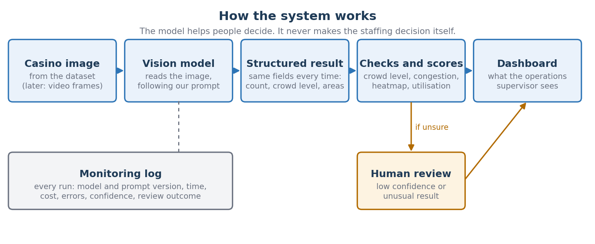
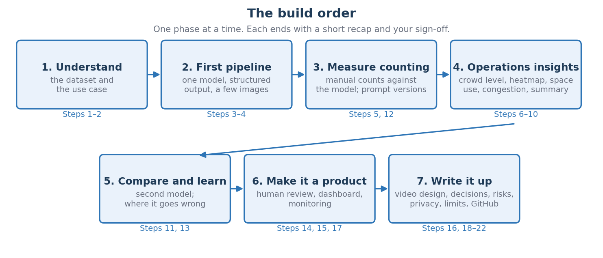

# Week 5 plan: Casino Floor Operations Intelligence System

**What this is:** your guide to Week 5. It explains what we're building, the order we'll build it in, the decisions you'll make, and, for every point in the brief, what we plan to do. As we go, each "Planned" line becomes "Done", with what we actually did, just as in Week 4.

**Status key:** Not started · In progress · Done

---

## 1. The project in one page

**The problem.** A casino has CCTV, but nobody can watch every area all the time. Operations staff need to know quickly:
- how busy each area is;
- where people are gathering;
- which areas look congested or empty.

**What we're building.** A prototype that takes a casino floor image and turns it into operations information:
- an estimated number of people;
- a crowd level: Normal, Busy or Highly occupied;
- busy and quiet parts of the image;
- possible congestion;
- a heatmap of where people are;
- a short summary for management.

It shows all of this on a dashboard. It **supports** a supervisor's decision; it never makes the decision itself.

**How.** A *multimodal model* (an AI that reads images as well as text) looks at each image and answers in a fixed format. We then check how accurate it is, especially at counting people, before trusting anything it says.

**Why images first.** Images are the data we have now. Later, video would show movement and change over time, so we design with that in mind (Step 16).

---

## 2. How we'll work

- **One phase at a time.** Each phase ends with a short recap and your sign-off before the next one starts.
- **Decisions:** for each one, I explain why it matters, give the options with their trade-offs and a recommendation, and you decide. Every decision goes in a decision log, as in Week 4.
- **Nothing leaves your computer without a yes.** That covers sending images to an online AI service and any upload.
- **You handle your own keys and accounts.** You create any accounts and paste API keys into a local file yourself, never into the chat.
- **Downloads and installs:** I give you the size first, and nothing happens until you say yes.
- **Comms:** short updates, small tables, and a simple diagram where it helps.

| Phase | Brief steps | What you'll have at the end |
|---|---|---|
| 1. Understand | 1–2 | A description of the dataset as it really is, and the use case written down |
| 2. First pipeline | 3–4 | One model analysing images into a fixed set of fields |
| 3. Measure counting | 5, 12 | Our own people counts against the model's, and the best of three prompts |
| 4. Operations insights | 6–10 | Crowd levels, a heatmap, space use, congestion and a management summary |
| 5. Compare and learn | 11, 13 | A second model compared with the first, and the failures explained |
| 6. Make it a product | 14, 15, 17 | Human review, the dashboard and monitoring |
| 7. Write it up | 16, 18–22 | Video design, decisions, risks, privacy, limitations, and GitHub |

---

## 3. Decisions you'll make

| # | Decision | When | The options, briefly |
|---|---|---|---|
| A | How we get the dataset | Phase 1 | Download it from Roboflow. This probably needs a free Roboflow account, which you'd create yourself. We'll check together |
| B | Which multimodal models | Phase 2 | **Decided (D5): Claude (online, main) and Moondream (on this Mac, for comparison)** |
| C | What counts as the "actual" number of people | Phase 1 (brought forward) | Our own manual count, with the dataset's labels as a cross-check only. **Decided (D3), after the inspection found the labels undercount** |
| D | Crowd level thresholds | Phase 4 | Set from the spread of counts in the dataset, and labelled as prototype values |
| E | Where the heatmap's positions come from | Phase 4 | The model marks where people are; or a separate person detector; or the dataset's labels (test images only) |
| F | How congestion is judged | Phase 4 | Many people in a small part of the image, with a written rule |
| G | When an image goes to human review | Phase 6 | Low confidence, the two models disagree, or the count is unusual |
| H | Dashboard and GitHub | Phase 6–7 | Streamlit on your computer, and a public repository, as in Week 4 |

---

## 4. What needs your yes before it happens

| What | Why | Before it happens you'll see |
|---|---|---|
| A Roboflow account | To download the dataset | What the account is for. You create it yourself |
| Downloading the dataset | To have the images | The size |
| Installing Python packages, and possibly Moondream | To run the tools | The size |
| API keys for a hosted model | To call Claude or OpenAI | Where to paste the key: a local file that stays off GitHub |
| Sending images to a hosted model | It's data leaving your computer | Which images, how many, and the estimated cost |
| Pushing to GitHub | Publishing the work | What's included |

The dataset is public, so sending its images to a hosted model is low risk. A real casino's footage would be a very different matter (Step 20).

---

## 5. Words you'll meet

| Word | Plain meaning |
|---|---|
| Multimodal model | An AI that understands images as well as text |
| Prompt | The instructions we give the model with each image |
| Structured output (JSON) | The answer in fixed, named fields instead of free text, so it can be stored and compared |
| Annotation, bounding box | A label in the dataset: a box drawn around a person or object, with its name |
| Ground truth | The correct answer we compare the model against, here our own careful count |
| Counting error | How far the model's count is from the true count |
| Heatmap | A coloured overlay: warm where people are, cool where they aren't |
| Confidence | How sure the model says it is. A claim, not a guarantee |
| Hallucination, unsupported statement | Something the model says that isn't actually in the image |

---

## 6. The brief, point by point

### Business scenario and dataset

| Brief says | What we plan to do | Status |
|---|---|---|
| Use casino images as the first version; video later | Build for single images now, with a design that takes video frames later (Step 16) | Done |
| Use Computer Vision and Multimodal AI to understand floor use | A multimodal model reads each image. Where it helps, simple calculations on its output (counts per area, heatmap) | Done |
| Don't simply identify objects; turn visuals into business insight | Every output ends in an operations question answered: how busy, where, does anyone need to look | Done |
| Use the Roboflow Casino Object Detection Dataset (version 3) | Download version 3 and record exactly which version and when (Decision A) | Done (D2, data/raw/MANIFEST.md) |
| Inspect the dataset properly before building | Phase 1 is all inspection. No model work until it's done | Done (docs/week5-dataset.md) |
| Don't assume information the dataset doesn't have | A dataset fact sheet records only what's actually there | Done (docs/week5-dataset.md) |
| Document what comes from the dataset and what's calculated or estimated | Every field we show is labelled **from the dataset**, **from the model (estimate)** or **calculated by us** | Done (docs/week5-dataset.md) |

### Main business problem and product goal

| Brief says | What we plan to do | Status |
|---|---|---|
| How many people are present in different areas | The model's count for the whole image, and per part of the image (for example left, centre, right) | Done |
| Which parts are highly occupied, and which underused | Busiest and quietest parts of each image, from the per-part counts and the heatmap | Done |
| Where people are gathering; whether areas look congested | Gathering points named by the model, and a congestion rule (Step 9) | Done |
| How occupancy changes between images or periods | Compare results across images. The dataset is unlikely to have times, so we'll be honest about what "change" can mean here | Done |
| Which areas may need attention | A "review suggested" flag with the reason, never an instruction | Done |
| Support human decisions, not make them | Wording and design say "suggest", "flag" and "review". There is no automatic staffing output | Done |
| Outputs: count, high and low activity, congestion, utilisation, objects, occupancy status, heatmap, summary | All ten become fields in the structured output (Step 4) and panels on the dashboard (Step 15) | Done |

### Step 1: Understand the dataset (Phase 1)

| Brief says | What we plan to do | Status |
|---|---|---|
| Review the dataset; what kinds of images | Look through the images and group them by type of scene | Done (docs/week5-dataset.md) |
| What annotations exist; which objects are labelled | List every label and how often it's used | Done (docs/week5-dataset.md) |
| How people are represented | Check how people are labelled, and whether partly hidden people are included | Done (docs/week5-dataset.md) |
| Number of images; variation between them | Count the images in each split (training, validation, test) and show a sample sheet | Done (docs/week5-dataset.md) |
| Some images more people, some scenes more crowded | Chart the number of labelled people per image | Done (docs/week5-dataset.md) |
| Lighting and camera angles vary | Measure brightness per image, and tag the camera angle on a sample | Done (docs/week5-dataset.md) |
| No extra assumptions until inspected; document the actual structure | Write a dataset fact sheet (`docs/week5-dataset.md`) | Done (docs/week5-dataset.md) |

### Step 2: Define the business use case (Phase 1)

| Brief says | What we plan to do | Status |
|---|---|---|
| Focus on floor operations: what does the team need to know | A one-page use case: who uses it, what question they're asking, and what they do next | Done (D4, docs/week5-use-case.md) |
| Primary focus: occupancy, concentration, congestion, space use | These four drive the output fields and the dashboard | Done (D4, docs/week5-use-case.md) |
| How it supports an operations manager; flag an area for review | A short example story: image in, flag raised, supervisor checks | Done (D4, docs/week5-use-case.md) |
| Don't decide staffing; inform the supervisor | Written as a product rule, and checked in the summaries (Step 10) | Done (D4, docs/week5-use-case.md) |

### Step 3: Use a multimodal model (Phase 2)

| Brief says | What we plan to do | Status |
|---|---|---|
| Use a multimodal model that analyses images (for example ChatGPT Vision or Moondream) | Choose the first model with you (Decision B) | Done (pipeline v1; D5, D6, D11) |
| Understand what can be extracted directly from an image | Run a few images and record what the model can and can't see reliably | Done for 5 trial images; measured in Phase 3 |
| Ask about people, crowd level, concentration, congestion, objects, observations | All six are in the prompt | Done (prompt trial-1) |
| Don't assume the model is right; evaluate it | Measured in Phase 3, and not trusted until then | In progress (Phase 3) |

### Step 4: Structured output (Phase 2)

| Brief says | What we plan to do | Status |
|---|---|---|
| No free text only; create a structured output | A fixed set of named fields. Answers that don't fit are rejected and logged | Done (structured output; CR-05) |
| Fields: count, crowd level, main occupied area, low-activity area, congestion, objects, confidence, summary | Exactly these, plus the model and prompt version and the time taken | Done (answer form v1) |
| Consistent across all images; JSON so results can be stored | Every answer is checked against the format, then saved to a results file | Done (5 of 5 fitted, both models) |

### Step 5: People count evaluation (Phase 3)

| Brief says | What we plan to do | Status |
|---|---|---|
| Manually select a set of images | About 30 images, from empty to crowded, light to dark | Done (30 test images, D10, CR-07) |
| Record the actual visible count for each | You and I count, using the dataset's person labels as a cross-check (Decision C) | Done (Tez's hand counts, D3, CR-08) |
| Compare with the model; table of actual, model, difference, result | The brief's table, filled in for every image | Done (evals/results/20261113_phase3_summary.md, section 5) |
| Average counting error | Average miss in people and in %, and whether the model leans high or low | Done: 2.6 people, 88% within (Opus + v3) |
| Where it does well and badly; inspect the hard images | The best and worst images shown side by side, and looked at by eye | Partly: well/badly done; inspection by eye in Step 13 |

### Step 6: Crowd level classification (Phase 4)

| Brief says | What we plan to do | Status |
|---|---|---|
| Categories such as Normal, Busy, Highly occupied | Use these three | Done (D14) |
| Prototype categories, not real casino standards | Labelled "prototype" everywhere they appear | Done (labelled prototype in outputs) |
| Define how they're calculated; document thresholds | A written rule based on the count (Decision D), with the reasoning | Done: 0–10 / 11–30 / 31+ (D14, CR-11) |
| Real thresholds would be agreed with operations, per area size | Stated in the rule, the product decisions and the limitations | Done (stated in D14) |

### Step 7: Heatmap generation (Phase 4)

| Brief says | What we plan to do | Status |
|---|---|---|
| A heatmap of where people are concentrated | Positions of people (Decision E), blurred into a warm-to-cool overlay on the image | Done (3×3 grid, D15, D17) |
| Highlight high activity and show low activity | The colour scale runs from empty to busiest, with a legend | Done (warm overlay, counts per square) |
| Compare with the original image to check it's right | Original and heatmap side by side, checked by eye on the evaluation images | Done: Tez checked all 30 side by side, all match (14 Nov) |

### Step 8: Space utilisation (Phase 4)

| Brief says | What we plan to do | Status |
|---|---|---|
| Estimate how parts of the floor are used | Split each image into a simple grid and count people per cell | Done (3×3 grid, shares per third and square) |
| Concentration around areas; empty or underused areas | Busiest and emptiest cells, named in plain words (for example "left side") | Done (busiest square, empty squares) |
| No exact percentages unless the data supports them | Shares of people per part of the image, not "% of capacity", because we don't know capacities | Done (shares of people only) |
| Separate measured from estimated | Every number is labelled measured, estimated or calculated | Done (every value tagged) |

### Step 9: Congestion analysis (Phase 4)

| Brief says | What we plan to do | Status |
|---|---|---|
| A simple congestion indicator: many people in a small space | Count per grid cell, against a written threshold (Decision F) | Done (D16) |
| Define how it's estimated | The rule written down, with examples | Done: any square 6–14 = Moderate, 15+ = High (D16, CR-13) |
| Status: No visible congestion / Moderate / High concentration requiring review | These three, exactly | Done |
| Prototype only; never claim "unsafe" | No safety words in any output, and the summaries are checked for them | Done (wording checked) |

### Step 10: Operational summary (Phase 4)

| Brief says | What we plan to do | Status |
|---|---|---|
| A short management summary after each analysis | Two to four sentences, written from the structured fields | Done (written from the fields) |
| Based only on the image and the structured analysis; nothing unsupported | The summary may only mention what's in the fields. We check for statements that go beyond them | Done (built only from the fields) |

### Step 11: Multimodal model comparison (Phase 5)

| Brief says | What we plan to do | Status |
|---|---|---|
| Compare two models on the same images | The same evaluation images, prompt and format through both (Decision B) | Done: Claude Opus 5.5 and Moondream, 30 images |
| Count accuracy, crowd class, observations, consistency, response time, cost, format reliability, unsupported statements | All eight measured. For consistency, each image is run more than once | Done (no unsupported statements, D20) |
| Comparison table; which suits the product and why | The brief's table, filled in, with a recommendation for you to decide | Done: Claude Opus 5.5 (D19) |

### Step 12: Prompt evaluation (Phase 3)

| Brief says | What we plan to do | Status |
|---|---|---|
| Version 1 simple; version 2 strict structure; version 3 adds operational rules and no unsupported conclusions | Exactly these three, saved as numbered files | Done (prompts/v1–v3) |
| Same images through each; compare | The evaluation images through all three, on the same measures as Step 11 | Done (both models, 30 images) |
| Which is most consistent and useful | Pick one, record why, and use it from then on | Done: v3 (CR-09, D12) |

### Step 13: Error analysis (Phase 5)

| Brief says | What we plan to do | Status |
|---|---|---|
| Select the images where the model does badly; analyse them manually | The worst images from Steps 5 and 11 | Done: 6 biggest misses (20261114_error_analysis.md) |
| Check crowding, hidden people, lighting, distance, reflections, blocking objects, angles, busy backgrounds | Each failure tagged with its likely causes | Done: each failure tagged |
| For each: expected, model result, difference, likely reason, possible improvement | A failure table with these five columns | Done (table, section 1) |

### Step 14: Human review (Phase 6)

| Brief says | What we plan to do | Status |
|---|---|---|
| Low confidence or unusual results go for review | Written triggers (Decision G) | Done: 5 triggers (D21); 10 of 30 flagged |
| Reviewer sees the image, output, count, crowd status, summary and confidence | A review screen in the dashboard | Done (dashboard, Review queue page) |
| Mark correct or incorrect; feedback used later | Saved with the reviewer's note, and counted in monitoring | Done: 10 reviews saved (15 Nov) |

### Step 15: Operations dashboard (Phase 6)

| Brief says | What we plan to do | Status |
|---|---|---|
| Show the image, count, crowd status, heatmap, congestion, summary, confidence, review flag | One page per image with all eight. Streamlit on your computer | Done (dashboard, Floor view page) |
| History when several images have been processed | A table and simple chart of past results | Done (History page) |

### Step 16: Prepare for future video (Phase 7)

| Brief says | What we plan to do | Status |
|---|---|---|
| Design so video can be added; analyse frames continuously | The pipeline takes "a frame with a time and camera", so a video is just many frames | Done: a frame = image + camera + time (FR-22 built); docs/week5-video-design.md |
| Movement, flow, change over time, repeated congestion, busy periods, movement between areas, averages by time, before and after decisions | A short design note: what each needs (time stamps, fixed camera areas, tracking) and what we'd add | Done: design note, section 4 |
| Don't build it all now | Design note only, plus the frame-based structure | Done: design only, plus the time-and-camera input |

### Step 17: Model monitoring (Phase 6)

| Brief says | What we plan to do | Status |
|---|---|---|
| Track model version, prompt version, response time, cost, counting error, failed requests, low confidence, review results, unsupported or incorrect answers | Every run logged with all of these, and a monitoring panel on the dashboard | Done (Monitoring page, scripts/monitoring.py) |
| Define what means the model needs investigation | Written alert rules, as in Week 4 (for example, the share of failed requests or rejected answers rising) | Done: alert limits (D22) |

### Step 18: Product decisions (Phase 7)

| Brief says | What we plan to do | Status |
|---|---|---|
| Document the important decisions | Decision log from day one (section 3 of `docs/casino-floor-intelligence-03-ai-architecture-and-decision-log.md`) | Done: decision log D1–D23 (03, section 3) |
| Which model and why; why structured output; crowd categories; human review; how the heatmap helps; what not to trust it with; what's needed for real use; how video extends it | One section each, pointing to the evidence | Done: docs/week5-product-decisions.md |

### Step 19: Risks (Phase 7)

| Brief says | What we plan to do | Status |
|---|---|---|
| Missed people; double counting; crowded scenes; lighting; camera angle; unsupported conclusions; real casino differs; inconsistent answers; privacy; staff over-trusting | A risk register, as in Week 4. Each risk with what we saw, the protection, what's left and an owner | Done: 16 risks with evidence (06, D24) |

### Step 20: Privacy and responsible use (Phase 7)

| Brief says | What we plan to do | Status |
|---|---|---|
| Focus on occupancy, not individuals | Outputs are counts and areas only | Done: docs/week5-privacy-and-responsible-use.md, section 1 |
| No facial recognition, no identifying customers, no personal characteristics | Not built, and the prompts tell the model not to describe people. Checked in testing | Done: not built; prompt forbids it; checked (D20, BU-12) |
| Who can access images; data retention; security | A short privacy note covering each | Done: sections 3–5 |
| Real use needs approval from privacy, security, legal and operations | Stated as a condition in the privacy note and the product decisions | Done: section 6 |

### Step 21: Limitations (Phase 7)

| Brief says | What we plan to do | Status |
|---|---|---|
| The dataset isn't every casino; camera position, lighting and crowding may change results | A limitations section, with the evidence from Steps 5, 11 and 13 | Done: docs/week5-limitations.md |
| Images can't show movement; video needed for flow and continuous occupancy | Stated plainly, and linked to the video design (Step 16) | Done: limitations section 4, linked to the video design |
| Present it as a prototype and starting point | Every document and the dashboard say "prototype" | Done: stated in every document and the dashboard |

### Step 22: Final deliverables (Phase 7)

| Brief says | Where it will be | Status |
|---|---|---|
| Dataset, and dataset analysis | `data/`, `docs/week5-dataset.md` | Done |
| Working multimodal pipeline, with structured output | `scripts/`, results files | Done |
| People count evaluation, crowd level, heatmap, congestion and space-use analysis | Evaluation documents and dashboard | Done |
| Model comparison, prompt comparison, error analysis | Evaluation documents | Done |
| Human review, dashboard, monitoring | Dashboard | Done |
| Video design, product decisions, privacy, limitations | Design and decision documents | Done |
| GitHub repository with a clear README | Public repository, as in Week 4 | Done |

---

## 7. First step

**Phase 1, Step 1: look at the dataset page together.** We open the Roboflow page in the browser, read what it says the dataset contains, and check how it can be downloaded (Decision A). Nothing is downloaded until you say yes.
