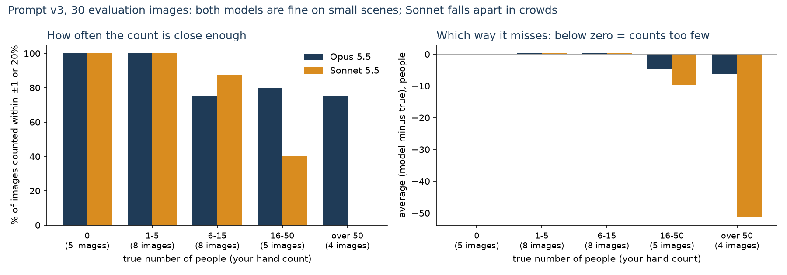

# Phase 3 results: counting, prompts and consistency (13 Nov 2026)

Steps 5 (people count evaluation), 12 (prompt evaluation) and part of 11 (consistency, cost, speed). True counts: Tez's hand counts on 30 test images (D3, D10).
Full detail: `evals/results/20261113_prompts.md`, `..._repeat.md`, the per-image CSVs, and `20261113_consistency.csv`. Spend: $4.33 for the 300 evaluation calls.

## 1. Prompts compared (Step 12), both models, 30 images each

| Model | Prompt | Images with a count | Average miss (people) | Within ±1 or 20% | Lean | Answers in the form | Cost per image |
|---|---|---|---|---|---|---|---|
| Opus 5.5 | v1: simple, free text | 6 of 30 | 37.3 | 33% | too low | 0% | $0.029 |
| Opus 5.5 | v2: the answer form | 30 | 3.5 | **90%** | −3.0 | 100% | $0.017 |
| Opus 5.5 | **v3: form + operational rules** | 30 | **2.8** | 87% | **−1.5** | 100% | $0.020 |
| Sonnet 5.5 | v1 | 6 of 30 | 37.3 | 0% | too low | 0% | $0.009 |
| Sonnet 5.5 | v2 | 30 | 10.5 | 60% | −9.7 | 100% | $0.006 |
| Sonnet 5.5 | v3 | 30 | 9.0 | 73% | −8.2 | 100% | $0.008 |

- **v1 can't be used:** only 6 of 30 free-text answers stated a number, none could be stored in the form, and it cost the most (long essays).
- **v3 is the most useful:** the smallest misses and least lean on both models, and it carries the rules on privacy, safety and unsupported statements. **Chosen for the consistency runs and recommended for the product.**

## 2. Where counting breaks (prompt v3)

| | Opus 5.5 within | Sonnet 5.5 within |
|---|---|---|
| 0 people (5 images) | 100% | 100% |
| 1–5 (8) | 100% | 100% |
| 6–15 (8) | 75% | 88% |
| 16–50 (5) | 80% | 40% |
| **Over 50 (4)** | **75%** | **0%** |
| Elevated, CCTV-like views (5) | 60% | 0% |
| Dark images (4) | 100% | 100% |

- Both models count small scenes reliably. **Crowds and high views are where the models differ:** Sonnet undercounts by about 50 people on average in the largest crowds.
- **Confidence is honest:** every "high" answer was right; the big misses were all marked "low". Low confidence is a sound review trigger (Decision G).

## 3. Consistency (prompt v3, each image 3 times)

| | Opus 5.5 | Sonnet 5.5 |
|---|---|---|
| Same count all 3 times | 63% of images | 57% |
| Average spread across the 3 runs | 3.0 people | 1.2 |
| Largest spread | 30 (E01) | 10 (E01) |
| Same crowd level all 3 times | 83% | 93% |
| Same congestion all 3 times | 77% | 97% |
| Within ±1 or 20%, all 90 answers | **88%** | 70% |
| Average miss, all 90 answers | **2.6** | 8.7 |
| Cost per image | $0.0196 | $0.0082 |

- Sonnet is steadier, but **steadily too low** in crowds. Opus varies a little in crowds (E01: 200–230) but stays close to the truth.
- **The model's own crowd level and congestion change between runs** (Opus: 83% and 77% the same). That supports working them out with **our written rules from the count** in Phase 4 (FR-07, FR-10), instead of trusting the model's labels.

## 4. A cheaper design, tested on these answers

Sonnet first, sending only its low-confidence answers to Opus: **same accuracy as Opus alone** (88% within, average miss 2.6), at **$0.0173 per image against $0.0196**. Only 12% cheaper here, because 43% of these images get escalated, and escalated images take two calls. Worth revisiting on a real floor, where most images would be quiet.

## 5. The brief's table (Step 5): Opus 5.5, prompt v3, first run

| Image | Group | Actual count | Model count | Difference | Result |
|---|---|---|---|---|---|
| E01 | crowded | 200 | 200 | +0 | good |
| E02 | crowded | 100 | 70 | -30 | under |
| E03 | crowded | 60 | 65 | +5 | good |
| E04 | crowded | 20 | 18 | -2 | good |
| E05 | dark | 20 | 17 | -3 | good |
| E06 | dark | 4 | 5 | +1 | good |
| E07 | dark | 0 | 0 | +0 | good |
| E08 | dark | 0 | 0 | +0 | good |
| E09 | empty (labelled) | 0 | 0 | +0 | good |
| E10 | empty (labelled) | 0 | 0 | +0 | good |
| E11 | empty (labelled) | 0 | 0 | +0 | good |
| E12 | empty (labelled) | 1 | 1 | +0 | good |
| E13 | close-up | 3 | 4 | +1 | good |
| E14 | close-up | 4 | 4 | +0 | good |
| E15 | busy | 12 | 12 | +0 | good |
| E16 | busy | 6 | 6 | +0 | good |
| E17 | busy | 6 | 13 | +7 | over |
| E18 | busy | 50 | 34 | -16 | under |
| E19 | busy | 10 | 10 | +0 | good |
| E20 | busy | 8 | 9 | +1 | good |
| E21 | busy | 90 | 90 | +0 | good |
| E22 | busy | 15 | 10 | -5 | under |
| E23 | quiet | 1 | 1 | +0 | good |
| E24 | quiet | 32 | 35 | +3 | good |
| E25 | quiet | 32 | 26 | -6 | good |
| E26 | quiet | 6 | 5 | -1 | good |
| E27 | quiet | 2 | 2 | +0 | good |
| E28 | quiet | 2 | 1 | -1 | good |
| E29 | quiet | 3 | 4 | +1 | good |
| E30 | quiet | 12 | 13 | +1 | good |

**Average counting error:** 2.8 people; **within ±1 or 20%:** 87% of images. Good on: empty, quiet, dark and close-up images. Bad on: the largest crowds and high wide views (Step 13 looks at these by eye).
